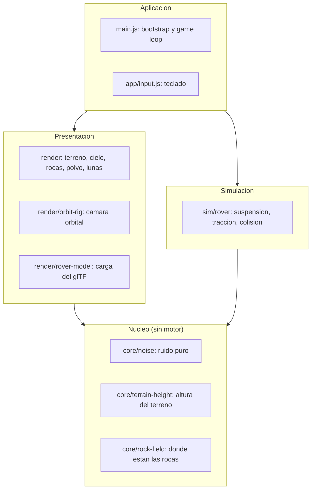

# Perseverance Mission

Simulador en tercera persona para conducir el rover **Perseverance** por un
campo de dunas marciano, con el modelo oficial de la NASA a escala real.

No es un paseo por un Marte de cartón: el rover mide sus 3 metros de verdad, se
inclina sobre las dunas apoyado en sus seis ruedas, deja huellas, levanta polvo
al correr y choca contra las rocas que no puede subir.

```
npm install
npm run fetch:model      # descarga el modelo de la NASA (4,76 MB)
npm run dev              # http://localhost:5173
```

| Tecla | Acción |
|---|---|
| `W` `A` `S` `D` | Conducir |
| `Shift` | Acelerar el tiempo (×700 en vez de ×120) |
| Arrastrar ratón | Orbitar alrededor del rover |
| Rueda | Zoom, de 3 m a 220 m |
| `C` | Recentrar la cámara detrás del rover |

---

## Qué hay hecho

- **Terreno procedural** de 6 km con dunas, borde de cráter conducible a 2,3 km
  y un parche de 1 m de resolución que sigue al rover.
- **Rover oficial de la NASA** (`nasa/NASA-3D-Resources`), 324 piezas, escalado
  calibrando contra el diámetro de rueda publicado: 52,5 cm.
- **Suspensión de 6 puntos**: cada rueda evalúa el terreno en su posición y el
  chasis deriva altura, cabeceo y alabeo de esos contactos.
- **Colisión con rocas**: las que sobresalen más de 55 cm —la altura libre real
  del chasis— son obstáculos; las menores se pasan por encima.
- **Huellas** con patrón de tacos, acostadas sobre la pendiente.
- **Polvareda** al correr, que se desvanece.
- **Cielo caramelo**, sol de tarde a 11°, polvo en suspensión, Fobos y Deimos.
- **`npm run check`**: lazo de verificación por captura (ver abajo).

---

## Arquitectura

Cinco capas con una sola regla: **las dependencias apuntan hacia abajo, nunca
hacia arriba.** El núcleo no sabe que existe un motor 3D.



El motor está aislado a propósito: `core/` es matemática pura y datos, sin un
solo `import` de three.js. Es lo que permite que la física y el dibujo lean
exactamente la misma verdad.

### La regla que más veces nos ha salvado

**Lo que se dibuja y lo que se simula tienen que ser la misma superficie.**

Suena obvio y ha costado tres fallos distintos:

1. Unos cerros decorativos que el terreno no conocía — el rover entraba *dentro*
   de la montaña. Ahora el borde del cráter vive en `heightAt()`.
2. El terreno lejano, con celdas de 16,7 m, asomaba por encima del parche de
   detalle. Se veía como charcos lisos, enterraba las huellas y dejaba pasar las
   llantas. Ahora esa malla se **recorta** donde manda el parche.
3. Las rocas se generaban dentro de la capa de render, así que la física no
   sabía que existían. Ahora viven en `core/rock-field.js` y las leen las dos
   capas.

Corolario: si algo con volumen tiene que estorbar, o es relieve (`heightAt`) o
es un objeto con colisión. Dibujar un obstáculo que la física desconoce es
dibujar una mentira.

---

## Verificación

`npm run check` abre la página en el Chrome **ya instalado**, invisible, con
`playwright-core` — que a diferencia de `playwright` no descarga navegadores —,
espera a que la escena confirme su primer frame, guarda una captura en
`checks/latest.png` y lista los errores de consola.

Falla si hay errores, si no se dibuja nada, si el rover no carga o si el terreno
lo atraviesa.

```
npm run check                                          # encuadre por defecto
CHECK_URL='http://localhost:5173/?drive=90' npm run check   # tras conducir 90 s
```

Parámetros de URL pensados para probar:

| Parámetro | Para qué |
|---|---|
| `?shot=hero` | Congela cámara y rover: capturas comparables entre rondas |
| `?drive=N` | Conduce N segundos antes de capturar — los fallos de movimiento no salen en una foto fija |
| `?at=x,z` | Arranca el rover donde se quiera, sin conducir kilómetros hasta allí |

---

## Qué es real y qué es aproximación

El proyecto declara sus licencias en vez de disimularlas.

**Real, de fuentes publicadas:** las medidas del rover (3,0 × 2,7 × 2,2 m,
1025 kg, ruedas de 52,5 cm), su velocidad máxima de 4,2 cm/s, la altura libre
del chasis, el modelo 3D y los nombres de sus piezas.

**Aproximado, y dicho:**

- **El terreno es procedural.** No es el relieve real del cráter Jezero. Cargar
  el DEM de la NASA sigue siendo una decisión abierta.
- **Fobos y Deimos están agrandadas.** A escala real, Deimos sería
  indistinguible de una estrella.
- **El tiempo va acelerado.** A 4,2 cm/s reales, recorrer su propio largo le
  toma al rover más de un minuto. El HUD muestra siempre la velocidad real
  equivalente y el factor aplicado.
- **Las seis ruedas no giran por separado.** El `.glb` de la NASA las trae como
  una sola malla.

---

## Decisiones abiertas

| # | Decisión | Estado |
|---|---|---|
| 1 | Terreno real de Jezero desde DEM de NASA | Abierta |
| 2 | Suspensión rocker-bogie articulada | Abierta |
| 3 | Waypoints de la misión con nota histórica y fuente | Abierta — es el pilar del proyecto |
| 4 | Corte temporal de la misión a cubrir | Abierta |

El punto 3 es el que da sentido a todo lo demás: waypoints en coordenadas reales
que al llegar conduciendo cuentan lo que la misión encontró ahí, cada uno con su
fuente oficial. La regla sigue en pie — **ninguna afirmación histórica llega a
pantalla sin una URL verificada**.

---

## Fuentes y créditos

- Modelo del rover: [nasa/NASA-3D-Resources](https://github.com/nasa/NASA-3D-Resources)
  — *"These assets are free and without copyright"*. Crédito **NASA/JPL-Caltech**.
- [Misión Mars 2020 Perseverance](https://science.nasa.gov/mission/mars-2020-perseverance/)
- [Dónde está el rover](https://mars.nasa.gov/mars2020/mission/where-is-the-rover/)
- [NASA Mars Trek — mapas y DEM](https://trek.nasa.gov/mars/)

Proyecto personal de aprendizaje, desarrollado con Claude Code durante un curso
de Platzi. Sin afiliación con NASA ni con el JPL.
