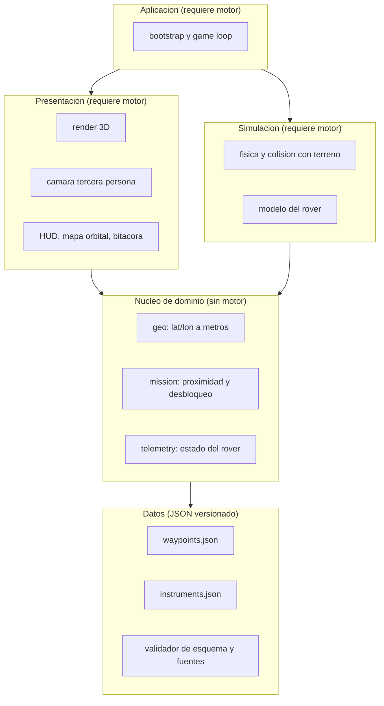

# Perseverance Mission

Simulador en tercera persona para conducir el rover **Perseverance** por el
cráter Jezero, en Marte — construido alrededor de los datos reales de la misión.

No es un paseo por un Marte inventado. Cada sitio del recorrido existe, está en
sus coordenadas verdaderas, y al llegar conduciendo hasta él desbloquea la nota
histórica de lo que la misión encontró ahí.

---

## Estado del proyecto

En diseño. El motor de render todavía **no está decidido** (ver
[Decisiones abiertas](#decisiones-abiertas)), y la arquitectura está hecha
precisamente para que esa decisión no bloquee el trabajo.

| Capa | Depende del motor | Estado |
|---|---|---|
| Datos | No | Lista para implementar |
| Núcleo de dominio | No | Lista para implementar |
| Simulación | Sí | Bloqueada |
| Presentación | Sí | Bloqueada |
| Aplicación | Sí | Bloqueada |

---

## Arquitectura

Cinco capas con una sola regla: **las dependencias apuntan hacia abajo, nunca
hacia arriba.** El núcleo no sabe que existe un motor 3D.



### Por qué así

El motor está sin decidir. En vez de esperar, el proyecto aísla todo lo que no
depende de él: la conversión de coordenadas marcianas, la lógica de misión, el
modelo de telemetría y los datos históricos. Eso es **la mitad del proyecto**, y
se puede construir y testear hoy.

Cuando el motor se elija, solo se escriben las tres capas superiores. Nada de lo
hecho se tira. El motor pasa a ser un detalle reemplazable, no el cimiento.

### Las capas

**Datos** — JSON versionado en `data/`. Waypoints reales con sus coordenadas,
sol, instrumentos y fuentes; especificaciones de instrumentos. Incluye un
validador que rechaza entradas sin fuente verificada.

**Núcleo de dominio** — lógica pura, sin un solo import del motor, cubierta con
tests. Tres módulos:
- `geo` — proyección de lat/lon marciana a metros en plano tangente local.
- `mission` — detección de proximidad, estado de desbloqueo, bitácora.
- `telemetry` — estado del rover (posición, rumbo, inclinación, instrumentos).

**Simulación** — física del vehículo y colisión con el terreno. Consume el
núcleo; no lo modifica.

**Presentación** — render 3D, cámara en tercera persona, HUD, mapa orbital y
fichas históricas. Solo lee del núcleo.

**Aplicación** — cableado y game loop. La única capa que conoce a todas las demás.

---

## Flujo de la función central

El recorrido completo del dato, desde el archivo hasta la pantalla:

```
waypoints.json
      |  carga + validación de esquema
      v
  [datos verificados]            <-- las entradas sin fuente se descartan aquí
      |  geo: lat/lon -> metros del mundo
      v
  [waypoints posicionados]
      |
      |<---- telemetry: posición actual del rover
      v
  mission: ¿distancia < radio de proximidad?
      |  sí
      v
  desbloqueo del waypoint
      |
      +--> HUD: aviso de llegada
      +--> mapa orbital: el pin pasa de silueta a activo
      +--> bitácora: se archiva la nota histórica con su fuente
```

El jugador conduce, llega, y el juego le cuenta algo cierto. Esa es toda la
propuesta.

---

## Estructura de carpetas

Objetivo. Las capas marcadas esperan la decisión del motor.

```
perseverance/
├── data/
│   ├── missions/
│   │   └── waypoints.json        # sitios reales + notas + fuentes
│   └── instruments/              # especificaciones de instrumentos
├── src/
│   ├── core/                     # dominio puro, sin motor
│   │   ├── geo/                  # conversión de coordenadas
│   │   ├── mission/              # proximidad, desbloqueo, bitácora
│   │   └── telemetry/            # estado del rover
│   ├── sim/                      # (pendiente del motor)
│   ├── render/                   # (pendiente del motor)
│   ├── ui/                       # (pendiente del motor)
│   └── app/                      # (pendiente del motor)
├── tests/                        # cobertura de core/ y del validador
├── CLAUDE.md                     # instrucciones de trabajo del proyecto
└── README.md
```

---

## Modelo de datos

Una entrada por sitio del recorrido:

```json
{
  "id": "octavia-e-butler-landing",
  "nombre": "Octavia E. Butler Landing",
  "sol": 0,
  "fechaTierra": "2021-02-18",
  "coordenadas": { "lat": 18.4447, "lon": 77.4508 },
  "unidadGeologica": "suelo del cráter",
  "instrumentos": ["Mastcam-Z", "MEDA"],
  "nota": "Qué ocurrió aquí.",
  "porQueImporta": "Su relevancia científica.",
  "fuentes": [{ "titulo": "", "url": "", "consultado": "" }],
  "imagenes": [{ "url": "", "credito": "NASA/JPL-Caltech", "licencia": "" }],
  "estado": "por-verificar"
}
```

### Invariante: ningún dato sin fuente

**Toda afirmación histórica que vea el jugador lleva una URL de fuente oficial.**
Sin fuente verificada, la entrada queda en `"estado": "por-verificar"` y el
validador la excluye del build. No se escriben notas de memoria: se consultan y
se citan.

Es una regla de arquitectura, no un buen deseo — vive en el validador de la capa
de datos, así que un dato sin respaldo no llega a pantalla ni por descuido.

---

## Conversión de coordenadas

Plano tangente local centrado en el punto de aterrizaje:

| Constante | Valor |
|---|---|
| Radio medio de Marte | `3 389 500 m` |
| Metros por grado de latitud | `R · π/180` ≈ `59 158 m` |
| Metros por grado de longitud en Jezero (~18.44°) | `59 158 · cos(18.4447°)` ≈ `56 124 m` |

Encapsulado en un único módulo (`core/geo`) y cubierto con tests: un error de
signo aquí desplaza todos los waypoints a la vez y no se detecta a ojo.

---

## Instrumentos

Cada instrumento real es una mecánica distinta, no un botón decorativo.

| Instrumento | Mecánica |
|---|---|
| Mastcam-Z | Modo foto con zoom y FOV real; las capturas entran a la bitácora |
| SuperCam | Láser a distancia sobre un objetivo, devuelve composición |
| PIXL / SHERLOC | Montados en el brazo; exigen acercarse y desplegar |
| RIMFAX | Radar de subsuelo, corte transversal bajo el rover |
| MEDA | Lectura ambiental: temperatura, viento, presión, opacidad |
| Taladro y tubos | Perforar, sellar y registrar el tubo de muestra usado |

---

## Hoja de ruta

- **Fase 0 — Datos y dominio.** Waypoints verificados con fuentes, validador,
  módulo de coordenadas con tests. *No requiere motor.*
- **Fase 1 — Esqueleto jugable.** Escena, terreno, rover controlable, cámara en
  tercera persona.
- **Fase 2 — Mapa y bitácora.** Mapa orbital, pines, proximidad, fichas históricas.
- **Fase 3 — Instrumentos.** Las mecánicas de la tabla anterior.
- **Fase 4 — Pulido.** Rendimiento, audio, despliegue.

---

## Decisiones abiertas

| # | Decisión | Impacto | Estado |
|---|---|---|---|
| 1 | Motor de render y física | Bloquea las fases 1 a 4 | Abierta |
| 2 | Terreno real desde DEM de NASA, o aproximación declarada | Capa de simulación | Abierta |
| 3 | Suspensión rocker-bogie articulada de 6 ruedas | Modelo del rover | Abierta |
| 4 | Alcance de fidelidad física (gravedad, energía, sol marciano) | Simulación y HUD | Abierta |
| 5 | Corte temporal de la misión a cubrir | Capa de datos | Abierta |

La número 5 importa más de lo que parece: el rover sigue operando, así que hay
que fijar una fecha de corte y datarla, o los datos envejecen en silencio.

---

## Fuentes

- [Misión Mars 2020 Perseverance](https://science.nasa.gov/mission/mars-2020-perseverance/)
- [Dónde está el rover (recorrido real)](https://mars.nasa.gov/mars2020/mission/where-is-the-rover/)
- [Imágenes crudas](https://mars.nasa.gov/mars2020/multimedia/raw-images/)
- [NASA Mars Trek — mapas y DEM](https://trek.nasa.gov/mars/)
- [DTM de HiRISE](https://www.uahirise.org/dtm/)
- [Analyst's Notebook (PDS)](https://an.rsl.wustl.edu/)
- [Modelos 3D de NASA](https://science.nasa.gov/3d-resources/)

El material de NASA es de dominio público y se acredita como `NASA/JPL-Caltech`.
Algunas imágenes tienen restricciones de terceros y se verifican antes de usarse.

---

## Créditos

Proyecto personal de aprendizaje, desarrollado con Claude Code durante un curso
de Platzi. Sin afiliación con NASA ni con el JPL.
